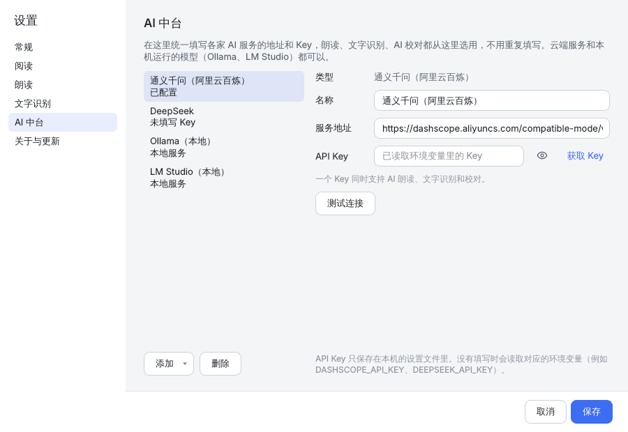
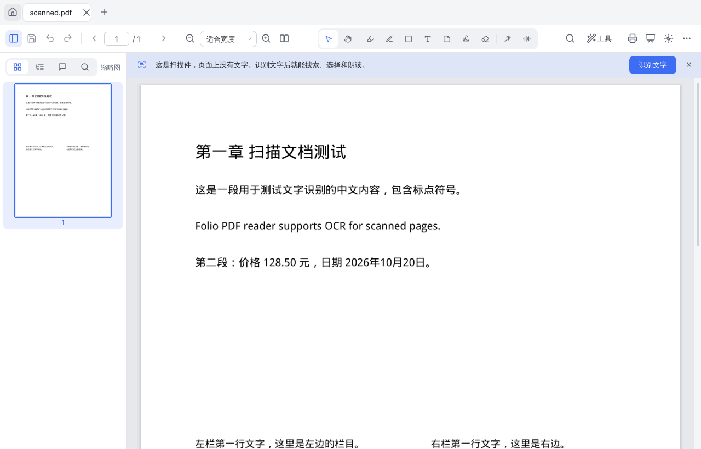

# Folio PDF

一个桌面 PDF 阅读器，可以阅读、批注、朗读、识别扫描件和处理 PDF。基于 PySide6 (Qt) 和 PyMuPDF，支持 Windows / macOS / Linux。


## 功能

**阅读**
- 连续滚动或双页显示，缩放、适合宽度、适合页面，放大时分块渲染，大文档也流畅
- 多标签页同时打开多个文件；再次打开文件时回到上次读到的位置
- 侧栏：缩略图、目录、批注列表、全文搜索（结果带上下文，所有命中项都会高亮）
- 页面颜色可选默认、护眼（米黄）、夜间（反色）；界面有浅色和深色两种主题
- 也能打开 EPUB、XPS、CBZ、FB2 等格式（只读，可另存为 PDF）

**批注**（保存为标准 PDF 注释，Adobe、浏览器等其它阅读器里同样能看到）
- 高亮、下划线、删除线、波浪线：在文字上拖动即可；在空白处拖动就变成荧光笔手绘
- 画笔、矩形、椭圆、直线、箭头（按住 Shift 画正方形、正圆或 45° 线）、文本框、便签
- 手写签名：画一次保存下来，之后点一下就能盖到页面上，可以存好几个签名切换使用
- 橡皮擦整条擦除；任何操作都可以撤销 / 重做，保存之后照样能撤销
- 右键单击批注可改颜色、编辑内容、删除
- **激光笔**：红点跟着鼠标走，按住拖动会画出一条自动消失的轨迹，什么都不会写进文件

**朗读**
- **点哪读哪**：选中「点读」工具后点击任意文字，从那一句开始朗读；正在读的句子会高亮，页面自动跟着翻
- 语音来源：**千问 AI 语音**（qwen3-tts-flash，30 多种音色，含粤语、四川话等方言）、**OpenAI 兼容语音**（OpenAI 或本机的语音服务）和**系统语音**（离线）
- 点读扫描页时会提示先识别文字，识别完自动开始朗读
- 会提前合成后面两句，句子之间不用等待；合成好的语音缓存在本地，同一段重复朗读不再计费
- 可以只读选中的文字，也可以设置跳过页眉、页脚和页码

**AI 中台**
- 在一个地方统一管理 AI 服务的地址和 Key，朗读、文字识别、AI 校对都从这里选用，不用重复填写
- 预设了通义千问（国内版 / 国际版）、DeepSeek、Kimi、智谱 GLM、硅基流动、OpenAI，以及本机运行的 Ollama、LM Studio；其它兼容 OpenAI 接口的服务（vLLM、llama.cpp、LocalAI、中转服务等）选「其他」填地址即可
- 「测试连接」会列出这个服务上可用的模型，之后选模型时直接下拉选择

**文字识别（OCR）**
- 扫描件、拍照的文档识别后可以搜索、选择、复制和朗读。识别结果作为隐藏文字写进 PDF，页面外观不变，可以撤销
- 识别方式可选：**系统自带**（Windows 10/11 的 Windows OCR、macOS 的文字识别、Linux 上的 Tesseract，离线免费）或 **AI 视觉模型**（千问 qwen3.5-ocr、本机 Ollama 的 qwen3-vl / glm-ocr 等）
- 可选 **AI 校对**：识别后用 DeepSeek、千问等文字模型改正错别字和标点，按行校对，不改写内容
- 打开扫描件时顶部会提示「识别文字」；也可以在「工具 → 文字识别」里选择页面范围

**PDF 工具**
- **压缩**：直接填写「每个文件不超过 X MB」，程序先做无损优化，不够再逐级降低图片分辨率，用二分法找到满足上限的最高画质。实在压不到时会告诉你最小能压到多少。也可以按压缩程度压缩，或批量处理多个文件
- **图片转 PDF**：照片、截图、长图都能转。长图按页面比例自动分页，并在空白行处切开，不会把一行字切成两半
- **合并**：PDF、图片、Word/Excel/PPT（需要安装 LibreOffice）、EPUB 都能合成一个 PDF，每个文件可以只取部分页，并自动生成书签
- **拆分**：每 N 页一个文件、按页码范围拆、每页一个文件，或按「每个文件不超过 X MB」拆
- **页面管理**：在缩略图上拖动调整顺序，右键可以旋转、删除、插入空白页、插入其他文件、提取为新 PDF

**打印**
- 选择打印机、份数、双面、纸张、方向
- 一张纸印 2/4/6/9 页、适合纸张或实际大小、带不带批注、黑白打印，右侧实时预览
- 没有打印机时也可以「导出为 PDF」，得到和打印效果一样的文件

**演示模式**（F5）
- 全屏单页显示；方向键、空格或单击翻页，右键返回上一页
- 自带激光笔、画笔、橡皮擦；按 B 黑屏

| 主页 | 压缩 | 图片转 PDF |
|---|---|---|
|  |  |  |

| 打印 | 演示模式 | 深色主题 |
|---|---|---|
|  |  |  |

| AI 中台 | 扫描件识别文字 |
|---|---|
|  |  |

## 安装与运行

### 直接下载（Windows / macOS）

每次推送代码，GitHub Actions 都会自动打包。打开仓库的 **Actions → 测试与打包**，选择最新一次运行，在 Artifacts 里下载 `Folio-windows` 或 `Folio-macos`。解压后运行 `Folio.exe` 或 `Folio.app` 即可，不用安装 Python。

正式版在 [Releases](https://github.com/xhc144/Claude-lab-2/releases/latest) 下载：Windows 推荐用 `Folio-Setup-版本号.exe` 安装（装在当前用户目录，不需要管理员权限，也可以在系统设置里卸载）；`Folio-windows.zip` 是免安装版。

推送 `v*` 标签（例如 `v0.2.1`）时，安装程序、压缩包和自动更新用的 `latest.json` 会自动发布到 Releases，发布说明开头的下载指引来自 `packaging/release-header.md`。

### 从源码运行

需要 Python 3.10 或更高版本：

```bash
pip install -r requirements.txt
python run.py              # 或者 python run.py 文件.pdf
```

### 自己打包

```bash
pip install -r requirements.txt pyinstaller
python packaging/build.py  # 输出到 dist/Folio
```

## AI 设置

所有 AI 服务都在 **更多（右上角 ⋯）→ AI 中台** 里设置，填一次 Key，朗读和文字识别都能用。

1. **千问**：到[阿里云百炼控制台](https://bailian.console.aliyun.com/)创建 API Key（新用户有免费额度），粘贴到「通义千问」连接里，点「测试连接」。一个 Key 同时支持 AI 朗读、文字识别和校对。国内版和国际版（新加坡）的 Key 不通用
2. **DeepSeek**：到 [DeepSeek 开放平台](https://platform.deepseek.com/api_keys)创建 Key。适合放在「文字识别 → AI 校对」里改错别字
3. **本机模型（不联网、不花钱）**：安装 [Ollama](https://ollama.com/download) 后运行 `ollama pull qwen3-vl`，在「设置 → 文字识别」里选「AI 识别：Ollama（本地）」即可。LM Studio 需要先在软件里启动本地服务
4. 选用哪个服务：
   - **设置 → 朗读**：选择语音来源（千问 AI 语音 / OpenAI 兼容语音 / 系统语音）、音色和语言
   - **设置 → 文字识别**：选择系统自带识别或某个 AI 连接和视觉模型，以及是否用 AI 校对

API Key 只保存在本机的设置文件里。不想在界面里填写时，也可以设置环境变量 `DASHSCOPE_API_KEY`、`DEEPSEEK_API_KEY`、`OPENAI_API_KEY` 等。没有 Key 或不想联网时，朗读用「系统语音」、识别用「系统自带」即可完全离线使用。

## 自动更新

打包版启动后会在后台检查新版本（每天最多一次，可在「设置 → 关于与更新」关闭）。发现新版本时显示更新说明，点「立即更新」后：

1. 下载对应系统的安装包，校验 SHA-256
2. 如果当前程序有数字签名，确认新版本是同一个签名者签的
3. 关闭 Folio（有未保存的文件会先提示保存），替换程序文件后自动重新打开

更新信息来自 GitHub Releases 里的 `latest.json`。访问 GitHub 慢时，可以把 `latest.json` 和安装包放到自己的服务器上，在「设置 → 关于与更新」里填写更新地址。

发布新版本：修改 `folio/__init__.py` 里的 `__version__`，在 `docs/CHANGELOG.md` 写好这一版的说明，然后推送标签：

```bash
git tag v0.2.0
git push origin v0.2.0
```

## 代码签名

签名能让 Windows 不再弹出「未知发布者」警告、macOS 不再提示「无法验证开发者」，自动更新也会用签名确认新版本来源可靠。

证书和密码放在 GitHub 仓库的 **Settings → Secrets and variables → Actions → New repository secret** 里。Secrets 加密保存，保存后任何人都看不到内容（包括仓库所有者自己），只有打包流程运行时能读取。没有设置的项目会自动跳过，不影响打包。

**Windows**（二选一）

| Secret 名称 | 内容 |
|---|---|
| `WINDOWS_CERT_PFX_BASE64`（也认 `WINDOWS_CERT_PFX`） | 代码签名证书 .pfx 文件的 Base64（PowerShell：`[Convert]::ToBase64String([IO.File]::ReadAllBytes("cert.pfx"))`） |
| `WINDOWS_CERT_PASSWORD` | .pfx 的密码 |

自签名证书（自己生成的 .pfx）也能用：程序会带上签名、自动更新会按证书指纹确认新版本来自同一张证书，但 Windows 不信任它，SmartScreen 仍会提示「未知发布者」。要去掉这个提示需要受信任机构签发的证书。

注意：2023 年 6 月以后新签发的代码签名证书，私钥必须存放在硬件（U 盾）或云端签名服务里，一般拿不到 .pfx 文件。这种情况推荐用微软的 [Azure Artifact Signing](https://learn.microsoft.com/azure/artifact-signing/)（原 Trusted Signing），设置下面这些 Secret：

| Secret 名称 | 内容 |
|---|---|
| `AZURE_TENANT_ID`、`AZURE_CLIENT_ID`、`AZURE_CLIENT_SECRET` | 有「Artifact Signing Certificate Profile Signer」权限的应用注册 |
| `AZURE_SIGNING_ENDPOINT` | 签名服务地址，例如 `https://eus.codesigning.azure.net/` |
| `AZURE_SIGNING_ACCOUNT` | 签名账户名称 |
| `AZURE_CERT_PROFILE` | 证书配置文件名称 |

**自动更新清单签名**（推荐设置，不需要买证书）

| Secret 名称 | 内容 |
|---|---|
| `UPDATE_SIGNING_KEY` | Ed25519 私钥，用 `python packaging/update_key.py gen` 生成；也支持 PEM 格式（`openssl genpkey -algorithm ed25519`） |

设置后，打包时把对应的公钥写进程序，发布时给 `latest.json` 签名；程序只安装签名正确的更新。
可以在本机用 `UPDATE_SIGNING_KEY=… python packaging/update_key.py check` 检查格式（不会显示密钥内容）。
注意：换密钥后，用旧密钥打包的版本将无法自动更新到新版本，需要手动下载一次。

**macOS**（需要 Apple Developer 账号）

| Secret 名称 | 内容 |
|---|---|
| `MACOS_CERT_P12` | 「Developer ID Application」证书导出的 .p12 文件的 Base64（`base64 -i cert.p12 \| pbcopy`） |
| `MACOS_CERT_PASSWORD` | 导出 .p12 时设置的密码 |
| `APPLE_ID` | Apple 账号邮箱（用于公证） |
| `APPLE_TEAM_ID` | 开发者团队 ID |
| `APPLE_APP_PASSWORD` | 在 appleid.apple.com 生成的 App 专用密码 |

## 快捷键

| 操作 | 快捷键 | 操作 | 快捷键 |
|---|---|---|---|
| 打开 | Ctrl+O | 选择文字 | V |
| 保存 / 另存为 | Ctrl+S / Ctrl+Shift+S | 抓手 | H（任何工具下按住空格或鼠标中键也能拖动） |
| 打印 | Ctrl+P | 高亮 | U |
| 撤销 / 重做 | Ctrl+Z / Ctrl+Y | 画笔 | P |
| 搜索 | Ctrl+F | 形状 | S |
| 放大 / 缩小 | Ctrl+= / Ctrl+-（或 Ctrl+滚轮） | 文本框 | T |
| 实际大小 / 适合宽度 / 适合页面 | Ctrl+0 / Ctrl+1 / Ctrl+2 | 便签 | N |
| | | 签名 | G |
| 侧栏 | F4 | 橡皮擦 | E |
| 演示模式 | F5 | 激光笔 | L |
| 全屏 | F11 | 点读 | R |
| 切换标签页 | Ctrl+Tab | 暂停 / 继续朗读 | Ctrl+Shift+Space |
| 关闭标签页 | Ctrl+W | | |

## 开发

```
folio/
  ai/          AI 中台：服务预设、连接管理、OpenAI 兼容接口客户端
  core/        与界面无关的处理逻辑：压缩、图片转 PDF、合并、拆分、文字定位与句子切分
  model/       文档模型：渲染、批注、页面管理、撤销/重做、保存
  ocr/         文字识别：系统识别引擎、AI 识别与校对、隐藏文字层、识别任务调度
  tts/         千问 TTS 客户端、语音引擎、朗读控制
  ui/          主窗口、页面视图、工具、侧栏、各种对话框
  update.py    自动更新
  assets/      图标（Lucide，ISC 许可）和 Logo
tests/         pytest：核心逻辑 + 无界面模式下的界面测试
packaging/     PyInstaller 打包、代码签名、更新清单脚本
```

运行测试（Linux 上测试文字识别需要安装 `tesseract-ocr tesseract-ocr-chi-sim`，没有时相关测试会跳过）：

```bash
pip install pytest
QT_QPA_PLATFORM=offscreen python -m pytest -q
```

打包后的程序可以用 `Folio --selftest result.json` 自检（CI 每次打包后都会运行）。

## 说明

- 按 Ctrl+S 保存会直接写回原文件（先写临时文件再替换，中途出错不会损坏原文件）；想保留原文件就用「另存为」。压缩、合并、拆分等工具总是生成新文件，不会覆盖原文件。
- 本项目依赖 PyMuPDF，它采用 AGPL-3.0 许可（另有商业许可）。自己使用或开源发布没有问题；如果要闭源分发，需要购买 MuPDF 商业许可，或者换用其它 PDF 引擎。
