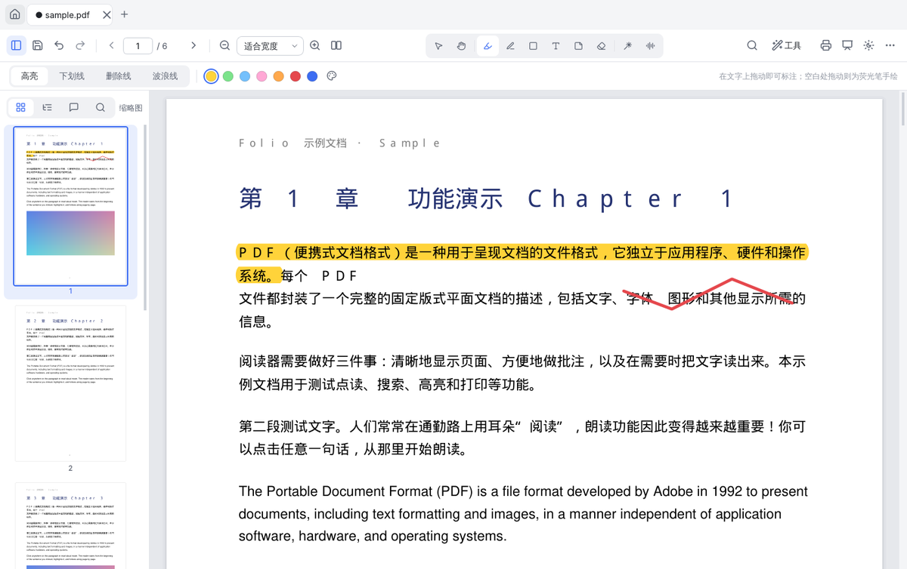
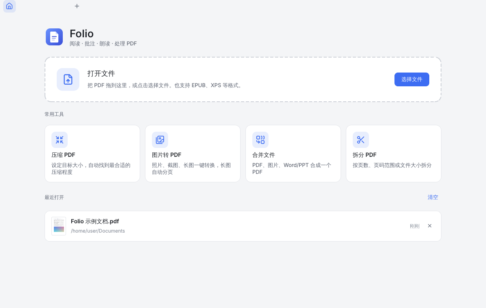
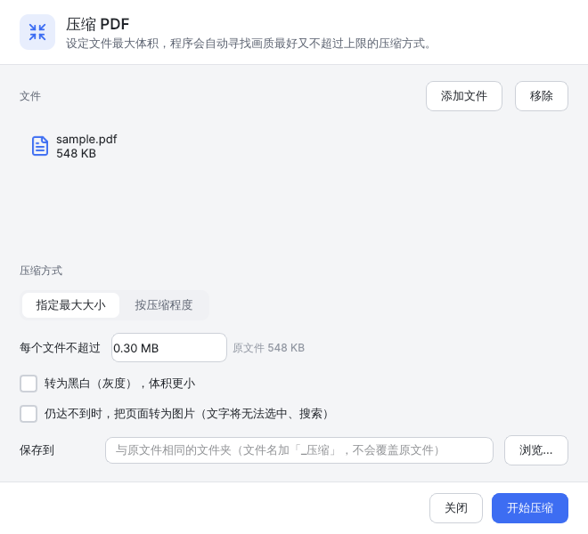
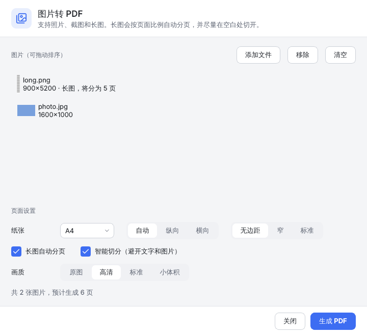
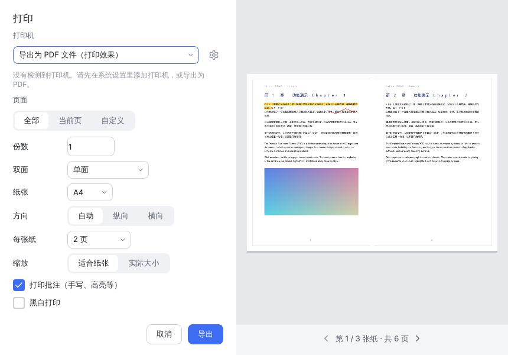
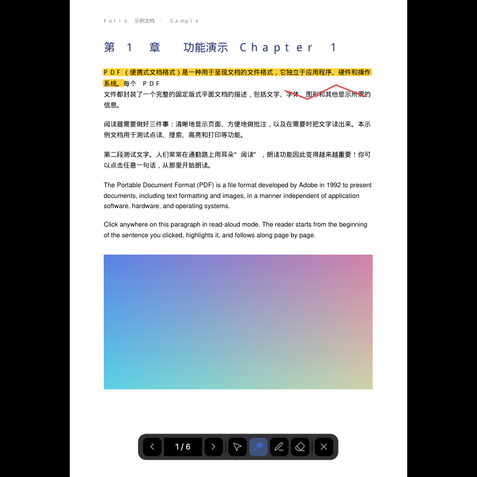
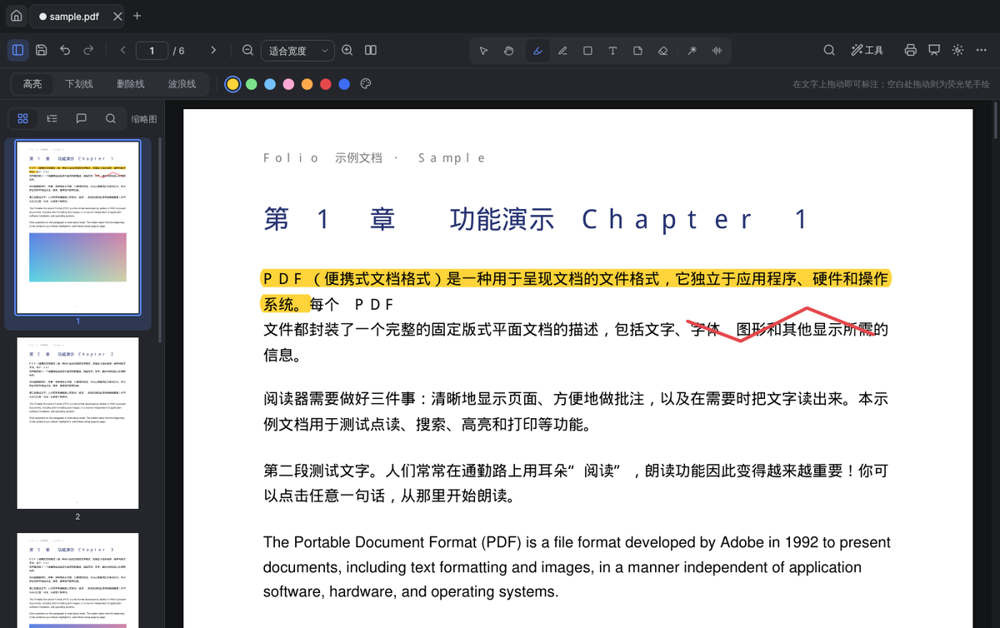

# Folio PDF

一个桌面 PDF 阅读器，可以阅读、批注、朗读和处理 PDF。基于 PySide6 (Qt) 和 PyMuPDF，支持 Windows / macOS / Linux。



## 功能

**阅读**
- 连续滚动或双页显示，缩放、适合宽度、适合页面，放大时分块渲染，大文档也流畅
- 多标签页同时打开多个文件；再次打开文件时回到上次读到的位置
- 侧栏：缩略图、目录、批注列表、全文搜索（结果带上下文，所有命中项都会高亮）
- 页面颜色可选默认、护眼（米黄）、夜间（反色）；界面有浅色和深色两种主题
- 也能打开 EPUB、XPS、CBZ、FB2 等格式（只读，可另存为 PDF）

**批注**（保存为标准 PDF 注释，Adobe、浏览器等其它阅读器里同样能看到）
- 高亮、下划线、删除线、波浪线：在文字上拖动即可；在空白处拖动就变成荧光笔手绘
- 画笔、矩形、椭圆、直线、箭头（按住 Shift 画正方形、正圆或 45° 线）、文本框、便签
- 手写签名：画一次保存下来，之后点一下就能盖到页面上，可以存好几个签名切换使用
- 橡皮擦整条擦除；任何操作都可以撤销 / 重做，保存之后照样能撤销
- 右键单击批注可改颜色、编辑内容、删除
- **激光笔**：红点跟着鼠标走，按住拖动会画出一条自动消失的轨迹，什么都不会写进文件

**朗读**
- **点哪读哪**：选中「点读」工具后点击任意文字，从那一句开始朗读；正在读的句子会高亮，页面自动跟着翻
- 两种语音引擎：**千问 AI 语音**（qwen3-tts-flash，30 多种音色，含粤语、四川话等方言）和**系统语音**（离线）
- 会提前合成后面两句，句子之间不用等待；合成好的语音缓存在本地，同一段重复朗读不再计费
- 可以只读选中的文字，也可以设置跳过页眉、页脚和页码

**PDF 工具**
- **压缩**：直接填写「每个文件不超过 X MB」，程序先做无损优化，不够再逐级降低图片分辨率，用二分法找到满足上限的最高画质。实在压不到时会告诉你最小能压到多少。也可以按压缩程度压缩，或批量处理多个文件
- **图片转 PDF**：照片、截图、长图都能转。长图按页面比例自动分页，并在空白行处切开，不会把一行字切成两半
- **合并**：PDF、图片、Word/Excel/PPT（需要安装 LibreOffice）、EPUB 都能合成一个 PDF，每个文件可以只取部分页，并自动生成书签
- **拆分**：每 N 页一个文件、按页码范围拆、每页一个文件，或按「每个文件不超过 X MB」拆
- **页面管理**：在缩略图上拖动调整顺序，右键可以旋转、删除、插入空白页、插入其他文件、提取为新 PDF

**打印**
- 选择打印机、份数、双面、纸张、方向
- 一张纸印 2/4/6/9 页、适合纸张或实际大小、带不带批注、黑白打印，右侧实时预览
- 没有打印机时也可以「导出为 PDF」，得到和打印效果一样的文件

**演示模式**（F5）
- 全屏单页显示；方向键、空格或单击翻页，右键返回上一页
- 自带激光笔、画笔、橡皮擦；按 B 黑屏

| 主页 | 压缩 | 图片转 PDF |
|---|---|---|
|  |  |  |

| 打印 | 演示模式 | 深色主题 |
|---|---|---|
|  |  |  |

## 安装与运行

### 直接下载（Windows / macOS）

每次推送代码，GitHub Actions 都会自动打包。打开仓库的 **Actions → 测试与打包**，选择最新一次运行，在 Artifacts 里下载 `Folio-windows` 或 `Folio-macos`。解压后运行 `Folio.exe` 或 `Folio.app` 即可，不用安装 Python。

推送 `v*` 标签（例如 `v0.1.0`）时，安装包还会自动发布到 Releases。

### 从源码运行

需要 Python 3.10 或更高版本：

```bash
pip install -r requirements.txt
python run.py              # 或者 python run.py 文件.pdf
```

### 自己打包

```bash
pip install -r requirements.txt pyinstaller
python packaging/build.py  # 输出到 dist/Folio
```

## 千问 AI 朗读设置

1. 到[阿里云百炼控制台](https://bailian.console.aliyun.com/)开通服务并创建 API Key（新用户有免费额度）
2. 在 Folio 中打开 **更多（右上角 ⋯）→ 设置 → 朗读**，粘贴 API Key，选择地域、音色，然后点「试听」确认能用
   - 北京地域和新加坡（国际）地域的 Key 不通用，要选对地域
   - 也可以不在界面里填，改为设置环境变量 `DASHSCOPE_API_KEY`
3. 没有 Key 或不想联网时，把语音引擎切换成「系统语音」即可离线朗读。Windows 自带中文语音；Linux 需要安装 speech-dispatcher

API Key 只保存在本机的设置文件里。

## 快捷键

| 操作 | 快捷键 | 操作 | 快捷键 |
|---|---|---|---|
| 打开 | Ctrl+O | 选择文字 | V |
| 保存 / 另存为 | Ctrl+S / Ctrl+Shift+S | 抓手 | H（任何工具下按住空格或鼠标中键也能拖动） |
| 打印 | Ctrl+P | 高亮 | U |
| 撤销 / 重做 | Ctrl+Z / Ctrl+Y | 画笔 | P |
| 搜索 | Ctrl+F | 形状 | S |
| 放大 / 缩小 | Ctrl+= / Ctrl+-（或 Ctrl+滚轮） | 文本框 | T |
| 实际大小 / 适合宽度 / 适合页面 | Ctrl+0 / Ctrl+1 / Ctrl+2 | 便签 | N |
| | | 签名 | G |
| 侧栏 | F4 | 橡皮擦 | E |
| 演示模式 | F5 | 激光笔 | L |
| 全屏 | F11 | 点读 | R |
| 切换标签页 | Ctrl+Tab | 暂停 / 继续朗读 | Ctrl+Shift+Space |
| 关闭标签页 | Ctrl+W | | |

## 开发

```
folio/
  core/        与界面无关的处理逻辑：压缩、图片转 PDF、合并、拆分、文字定位与句子切分
  model/       文档模型：渲染、批注、页面管理、撤销/重做、保存
  tts/         千问 TTS 客户端、语音引擎、朗读控制
  ui/          主窗口、页面视图、工具、侧栏、各种对话框
  assets/      图标（Lucide，ISC 许可）和 Logo
tests/         pytest：核心逻辑 + 无界面模式下的界面测试
packaging/     PyInstaller 打包脚本
```

运行测试：

```bash
pip install pytest
QT_QPA_PLATFORM=offscreen python -m pytest -q
```

## 说明

- 按 Ctrl+S 保存会直接写回原文件（先写临时文件再替换，中途出错不会损坏原文件）；想保留原文件就用「另存为」。压缩、合并、拆分等工具总是生成新文件，不会覆盖原文件。
- 本项目依赖 PyMuPDF，它采用 AGPL-3.0 许可（另有商业许可）。自己使用或开源发布没有问题；如果要闭源分发，需要购买 MuPDF 商业许可，或者换用其它 PDF 引擎。
